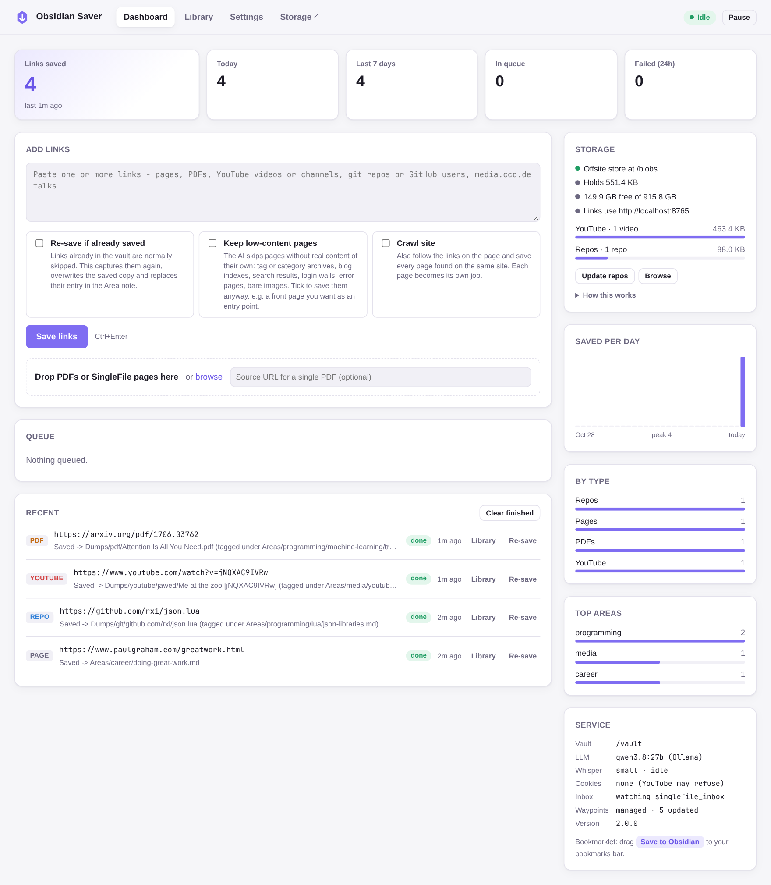
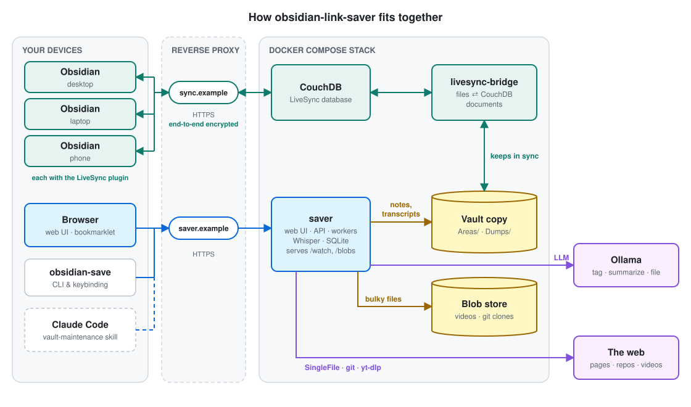
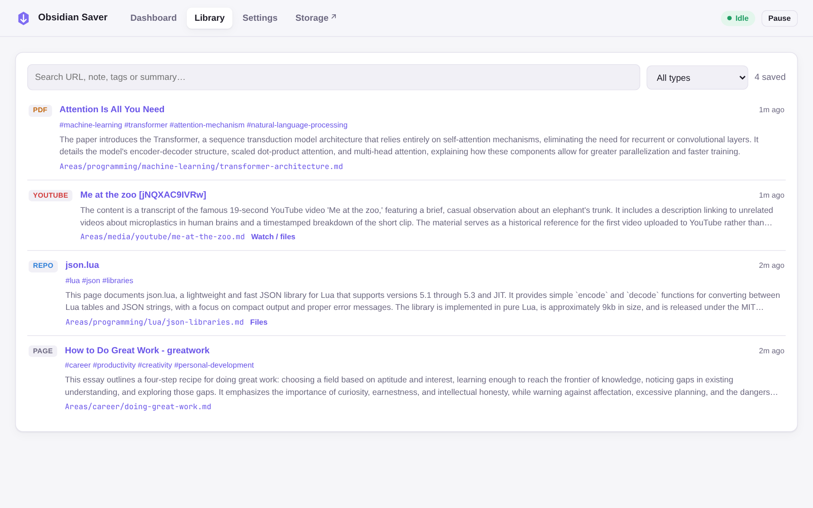
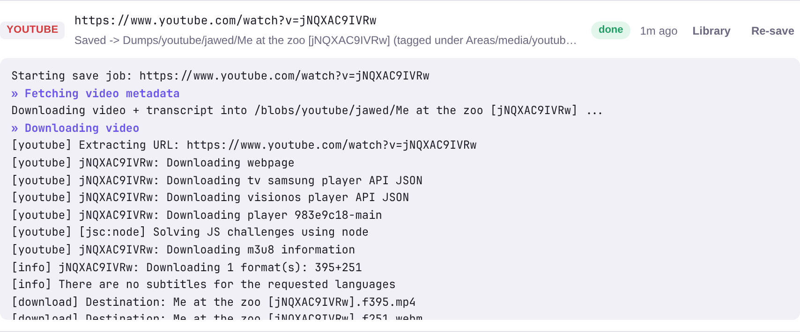
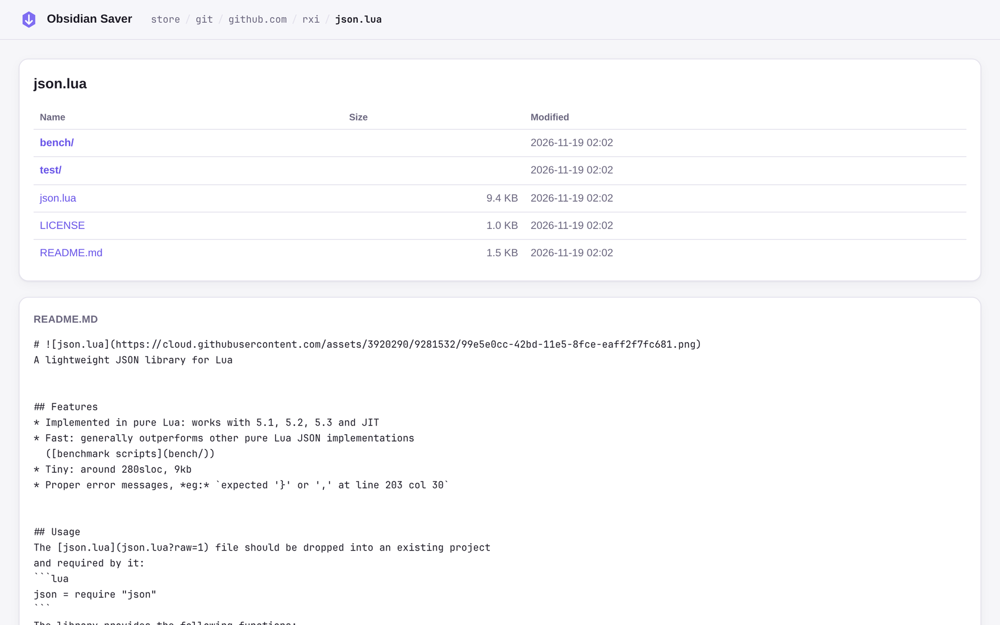
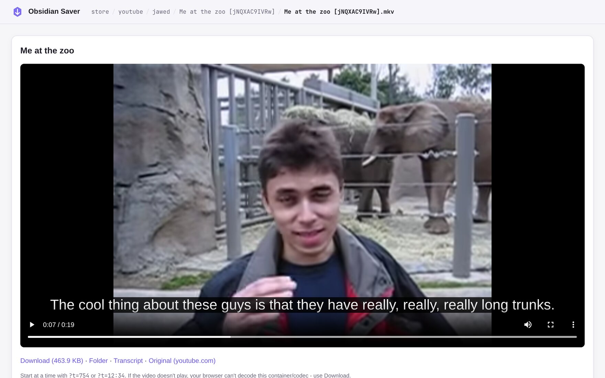

# obsidian-link-saver

A self-hosted service that turns links into notes in your Obsidian vault.
Paste a URL (or use the bookmarklet, a keybinding, or the API) and it:

- captures web pages with [SingleFile](https://github.com/gildas-lormeau/single-file-cli),
  clones git repositories, downloads PDFs and videos (YouTube and anything
  [yt-dlp](https://github.com/yt-dlp/yt-dlp) supports);
- transcribes videos with Whisper (on an NVIDIA GPU if you have one);
- tags, summarizes and files each link with a local LLM through
  [Ollama](https://ollama.com), as a bullet in a topic note under `Areas/`;
- keeps bulky files (videos, full clones) in a blob store outside the vault,
  served by the service, so your devices only sync what's worth searching.

The Docker Compose stack also runs
[Self-hosted LiveSync](https://github.com/vrtmrz/obsidian-livesync), so
everything the service writes reaches your desktop and phone within seconds.
A [Claude Code](https://claude.com/claude-code) skill for auditing and
restructuring the vault is included.

<picture><source media="(prefers-color-scheme: dark)" srcset="docs/screenshots/dashboard-dark.png"></picture>

> [!WARNING]
> **This repository was implemented largely with AI.** Most of the code,
> tests and documentation were written with an AI coding assistant
> ([Claude Code](https://claude.com/claude-code)), directed and reviewed by
> the author but not audited line by line. It runs on the author's own
> server, and it has a test suite, but expect rough edges. It writes into
> your vault and syncs the result to all your devices, so **back up your
> vault before you start**, and read what you run.

> [!CAUTION]
> **Authentication is minimal, and off by default.** The only protection
> is one shared secret, `API_TOKEN`. While it's empty (the default),
> anyone who can reach the service can use the whole API: save links,
> upload files into your vault, change settings. Even with a token set, the
> blob store isn't protected: `/blobs`, `/watch` and `/subs` (your stored
> videos, cloned repos and subtitles) stay open, because notes link to
> them directly. Don't expose it to the internet as it is: put it behind a
> reverse proxy that handles authentication, or keep it on a private
> network such as [Tailscale](https://tailscale.com) (see
> [step 4](#4-set-up-the-reverse-proxy)). Either way, set `API_TOKEN` (see
> [Configure](#5-configure)).

## How it fits together

<picture>
  <source media="(prefers-color-scheme: dark)" srcset="docs/architecture-dark.svg">
  
</picture>

The service (`saver`) writes into a copy of the vault on the server. The
bridge keeps that copy and CouchDB in sync, and the LiveSync plugin syncs
CouchDB with every device. Without the bridge, nothing the service writes
would reach your devices.

The vault layout it uses (created when missing):

```
<vault>/
  Areas/<area>/…/<topic>.md    topic notes; each saved link is one bullet
  Areas/<area>/<area>.md       folder notes with a generated index (Waypoint format)
  Dumps/                       captures: single_page/, pdf/, git/, youtube/, video/
  Dumps/singlefile_inbox/      drop SingleFile pages or PDFs here to import them
```

## Screenshots

All taken on a fresh [quick start](#quick-start-on-your-own-machine) after
saving four links.

| | |
|---|---|
| <picture><source media="(prefers-color-scheme: dark)" srcset="docs/screenshots/library-dark.png"></picture> | <picture><source media="(prefers-color-scheme: dark)" srcset="docs/screenshots/job-log-dark.png"></picture> |
| **Library:** everything saved, searchable, with links to the note and the stored files | **Job log:** each stage of a save; videos are filed by their transcript |
| <picture><source media="(prefers-color-scheme: dark)" srcset="docs/screenshots/repo-browser-dark.png"></picture> | <picture><source media="(prefers-color-scheme: dark)" srcset="docs/screenshots/watch-dark.jpg"></picture> |
| **Stored repositories:** the full clone lives outside the vault, browsable | **Video player:** stored videos play in the browser with Whisper subtitles |

## Quick start (on your own machine)

To try it out before setting up a server, run just the service locally:
no proxy, no LiveSync, no GPU. It writes into a throwaway vault that you
open directly in Obsidian. You need Docker and
[Ollama](https://ollama.com/download) with a model pulled
(`ollama pull <model>`).

```sh
git clone https://github.com/<owner>/obsidian-link-saver.git
cd obsidian-link-saver
mkdir -p playground/vault playground/blobs
PUID=$(id -u) PGID=$(id -g) OLLAMA_MODEL=<model> \
  docker compose -f docker-compose.quickstart.yml up --build
```

The first build takes several minutes (Chromium, Node, faster-whisper).
Then:

1. Open <http://localhost:8765>, paste a link (an article, a GitHub repo, a
   short YouTube video) and watch the job's progress and log.
2. In Obsidian, *Open folder as vault* → `playground/vault`. The entry
   appears as a bullet in a note under `Areas/`, with the capture under
   `Dumps/`. Videos and full clones go to `playground/blobs` and open from
   the note's links in your browser.

Notes:

- **Ollama on Linux** listens only on `127.0.0.1` by default, which
  containers can't reach. Either run it with `OLLAMA_HOST=0.0.0.0` (for the
  systemd service: `sudo systemctl edit ollama`, add
  `Environment="OLLAMA_HOST=0.0.0.0"` under `[Service]`, restart it; mind
  your firewall), or point `OLLAMA_URL` at another Ollama. Docker Desktop
  (macOS, Windows) reaches the host's Ollama as is.
- Timestamps in notes and job logs use the container's time zone, UTC
  unless you add your own in front of the command, e.g. `TZ=Europe/Berlin`.
- Transcription runs on the CPU with Whisper `small`; long videos take a
  while.
- Everything stays in `playground/`, which git ignores. Stop with Ctrl-C;
  `docker compose -f docker-compose.quickstart.yml down` removes the
  container, and deleting `playground/` removes the rest.

## Bootstrap

This walks through a fresh install on a server. Commands use example paths under
`/srv/obsidian`; put the folders wherever suits your server. On Unraid, see
[Running on Unraid](#running-on-unraid) as you go.

### 1. What you need

- A Linux server with Docker and Compose v2.
- An Ollama server with a model pulled, e.g. `ollama pull qwen3.8:27b`.
  Smaller models work too; set `OLLAMA_MODEL` to match. Ollama can run on
  the same host.
- A reverse proxy with HTTPS and two hostnames pointing at the server: one
  for the web UI (`saver.example.com` below) and one for CouchDB
  (`sync.example.com`). The Obsidian mobile app only syncs over HTTPS. The
  names can resolve to a LAN address if you only sync at home.
- Optional: an NVIDIA GPU with the
  [NVIDIA Container Toolkit](https://docs.nvidia.com/datacenter/cloud-native/container-toolkit/)
  for fast transcription.
- Obsidian on your devices.

### 2. Get the code onto the server

```sh
git clone https://github.com/<owner>/obsidian-link-saver.git /srv/obsidian/stack
cd /srv/obsidian/stack
```

The images are built from this clone, and `deploy/update.sh` updates it
later. None of your data lives in it.

### 3. Create the folders

```sh
mkdir -p /srv/obsidian/vault /srv/obsidian/blobs /srv/obsidian/data
chown 1000:1000 /srv/obsidian/vault /srv/obsidian/blobs   # the PUID:PGID you'll set in .env
```

| Folder | `.env` | Holds |
|---|---|---|
| `vault` | `VAULT_DIR` | The server's copy of the vault |
| `blobs` | `BLOBS_DIR` | Videos and full git clones. Never inside the vault |
| `data` | `DATA_DIR` | The service's database, CouchDB, the bridge's state |

- **You already have a vault:** copy it into `vault` now, for example
  `rsync -a ~/obsidian/ server:/srv/obsidian/vault/`, and make it owned by
  `PUID:PGID`. If another sync tool (Syncthing, Nextcloud, ...) syncs this
  vault, stop it on every device before step 7: two sync tools on one vault
  replay each other's changes.
- **You're starting fresh:** leave `vault` empty. The service creates
  `Areas/` and `Dumps/` on its first start.

### 4. Set up the reverse proxy

`saver` and `couchdb` join an external Docker network (`PROXY_NETWORK`,
default `proxy`) so the proxy reaches them by container name. If your proxy
has no such network yet, create one and attach the proxy to it:

```sh
docker network create proxy
```

With [Caddy](https://caddyserver.com), the two sites are:

```
saver.example.com {
    reverse_proxy obsidian-saver:8765
}
sync.example.com {
    reverse_proxy obsidian-couchdb:5984
}
```

CouchDB has no host port; it's reachable only through the proxy. If your
proxy runs on the host instead of in Docker, still create the network, and
publish CouchDB on loopback in a `docker-compose.override.yml` (git-ignored):

```yaml
services:
  couchdb:
    ports: ["127.0.0.1:5984:5984"]
```

The `/blobs` and `/watch` routes (videos, repo files) have no login, because
notes link to them directly. Keep `saver.example.com` on your LAN, or
have the proxy handle authentication.

**Not exposing it at all:** [Tailscale](https://tailscale.com) is a valid
alternative to a reverse proxy. With Tailscale on the server and your
devices, both services are reachable only inside your tailnet (your private
Tailscale network), and nothing is open to the internet.
[`tailscale serve`](https://tailscale.com/kb/1312/serve) provides the HTTPS
(a `*.ts.net` certificate) that the Obsidian mobile app needs, for example:

```sh
tailscale serve --bg --https=443 http://127.0.0.1:8765     # the web UI and API
tailscale serve --bg --https=8443 http://127.0.0.1:5984    # CouchDB (publish it on loopback, above)
```

Then set `PUBLIC_URL=https://<server>.<tailnet>.ts.net` and
`LIVESYNC_PUBLIC_URL=https://<server>.<tailnet>.ts.net:8443`. The proxy
network must still exist (`docker network create proxy`), even though
nothing else joins it.

### 5. Configure

```sh
cp .env.example .env
sed -i \
  -e "s/^COUCHDB_PASSWORD=$/COUCHDB_PASSWORD=$(openssl rand -hex 24)/" \
  -e "s/^LIVESYNC_PASSPHRASE=$/LIVESYNC_PASSPHRASE=$(openssl rand -hex 24)/" \
  -e "s/^LIVESYNC_ID_KEY=$/LIVESYNC_ID_KEY=sls-id-v1:$(openssl rand -hex 32)/" \
  .env
grep -E '^(COUCHDB_PASSWORD|LIVESYNC_PASSPHRASE|LIVESYNC_ID_KEY)=' .env
```

The `sed` fills the three secrets and never overwrites a value already set.
Put what the `grep` prints into your password manager: without the
passphrase, the synced data can't be decrypted. Then edit `.env` and replace
every placeholder:

| Variable | Set it to |
|---|---|
| `VAULT_DIR`, `BLOBS_DIR`, `DATA_DIR` | The folders from step 3 |
| `PUID`, `PGID` | The owner of `VAULT_DIR` (`id -u`, `id -g`) |
| `PROXY_NETWORK` | Your proxy's Docker network |
| `PUBLIC_URL` | `https://saver.example.com`. It's written into note links, so choose it once |
| `LIVESYNC_PUBLIC_URL` | `https://sync.example.com` |
| `OLLAMA_URL`, `OLLAMA_MODEL` | Your Ollama (`http://host.docker.internal:11434` if it runs on the Docker host) and model |
| `TZ` | Your time zone, for timestamps in notes |
| `API_TOKEN` | Optional, but recommended: a secret (`openssl rand -hex 24`). The web UI asks for it once; the client and the skill read it from `SAVE_SERVICE_TOKEN`. Empty, the API is open |

No NVIDIA GPU? Delete the `deploy:` block under `saver` in
`docker-compose.yml`, and consider `WHISPER_MODEL=small` or `medium`.

Check the result: `docker compose config -q` prints nothing when every
required value is set, and names the missing one otherwise. All other
settings are listed in
[docs/reference.md](docs/reference.md#configuration-environment-variables).

### 6. Start the stack

```sh
docker compose up -d --build
curl -fsS https://saver.example.com/api/health      # {"ok":true,...}
docker compose logs -f livesync-bridge
```

The first build takes a while: it installs Chromium, Node and about 1.5 GB
of Python packages (faster-whisper with NVIDIA's CUDA libraries). The
bridge then logs *Waiting for the first Obsidian device to initialise...*:
it adopts the database settings the first device chooses, in the next step.

### 7. Connect the first device

Print the Setup URI, and note the passphrase it shows (it protects only the
URI):

```sh
docker compose run --rm livesync-setup-uri
```

Set up the first device **with a new, empty vault**, so that the server's
copy is what fills CouchDB:

1. In Obsidian, create a new empty vault and install the community plugin
   *Self-hosted LiveSync*.
2. Choose *I am setting this up for the first time* → *Use a Setup URI*,
   and paste the URI and its passphrase.
3. Choose *Restart and Initialise Server* → *Overwrite Server* → *Use this
   device's settings*.

Within 15 seconds the bridge picks up those settings and uploads the
server's vault. Watch its log until it settles; a large vault takes a
while. The empty vault on the device then fills with your notes. If you
started fresh, this vault can simply become your vault.

### 8. Add your other devices

In the first device's vault, run the command *Self-hosted LiveSync: Copy
settings as a new Setup URI*. On each other device, install the plugin and
choose *I am adding a device to an existing synchronisation setup* → *Use a
Setup URI* → *Restart and Fetch Data*:

- **The device's vault matches the server's copy** (it's where you copied
  the vault from): open that vault, and pick *Compare time and take newer*
  and *Recreate remote files even if they were deleted on remote*. Nothing
  local is deleted.
- **The device's vault is out of date, or there is none:** use a new, empty
  vault and pick *Overwrite all with remote files*. An old vault's stale and
  deleted notes would otherwise be uploaded again as if they were new.
  Copy over its `.obsidian` folder afterwards if you want its settings.

LiveSync doesn't sync `.obsidian` (settings, plugins) unless you enable its
*Customization sync*.

### 9. Finish the setup

- If you use the **Waypoint** plugin, turn it off on every device: the
  service now writes the folder-note indexes, and two writers cause
  conflicts. Without the plugin, the indexes still appear.
- Open `https://saver.example.com` and save a first link. Its job log shows
  each stage; the entry appears under `Areas/` on your devices moments after
  it finishes.
- **YouTube cookies** (recommended; YouTube often blocks anonymous
  downloads): in the dashboard's *YouTube cookies* card, upload a
  `cookies.txt` exported from a logged-in browser ("Get cookies.txt LOCALLY"
  or Cookie-Editor's JSON). Export from a private window and close it
  afterwards, because YouTube rotates the cookies of sessions that stay open.
- Drag the *Save to Obsidian* bookmarklet from the dashboard's Service card
  to your bookmarks bar.

### 10. Desktop client (optional)

`client/obsidian-save` is a dependency-free Python script for the terminal
and for a keybinding: without arguments it takes the link from the clipboard
(`wl-paste`) or a [Walker](https://github.com/abenz1267/walker) prompt, and
reports the result with `notify-send`. On your desktop:

```sh
git clone https://github.com/<owner>/obsidian-link-saver.git ~/src/obsidian-link-saver
mkdir -p ~/.config/obsidian-save
cp ~/src/obsidian-link-saver/client/client.env.example ~/.config/obsidian-save/client.env
$EDITOR ~/.config/obsidian-save/client.env          # SAVE_SERVICE_URL, and the token if you set API_TOKEN
ln -s ~/src/obsidian-link-saver/client/obsidian-save ~/.local/bin/obsidian-save
ln -s ~/src/obsidian-link-saver/client/obsidian-save ~/.local/bin/obsidian-crawl-site   # crawls by default
```

`obsidian-save URL… [--force] [--thin] [--crawl --depth 2 --pages 30] [--file paper.pdf --source URL] [--wait]`.
Bind `obsidian-save` to a key in your desktop environment.

### 11. Claude Code skill (optional)

`skills/vault-maintenance` audits and restructures `Areas/` (duplicates,
stale links, misfiled entries, oversized folders) and keeps the service's
registry and folder indexes in sync. Install it as a personal skill, from
the desktop clone of step 10:

```sh
mkdir -p ~/.claude/skills
ln -s ~/src/obsidian-link-saver/skills/vault-maintenance ~/.claude/skills/vault-maintenance
```

Then run Claude Code inside your vault and ask it to audit or reorganize
the vault. The scripts find the vault from the working directory (or
`OBSIDIAN_VAULT`) and the service from the same `client.env` as the client.
To have the skill only in that vault, link it into `<vault>/.claude/skills/`
instead. A symlink, rather than a copy, keeps it updated with `git pull`.

## Updating

On the server, in the clone:

```sh
deploy/update.sh
```

It fetches, shows the incoming commits, fast-forwards, rebuilds the images
and restarts the stack only if the build succeeded, asking before each step
(`-y` skips the questions). It prints a rollback command at the end. Your
data folders are never touched. To update only yt-dlp, restart the `saver`
container.

Without git on the server, `deploy/push.sh user@host /path/on/server` copies
a local clone over (it never touches the server's `.env` or `data/`); then
run `docker compose up -d --build` there.

## Backups

| What | Where | How |
|---|---|---|
| Secrets | `.env` | Keep the three secrets in a password manager |
| CouchDB, registry, bridge state | `DATA_DIR` | Stop the stack and copy the folder, or snapshot it |
| Videos and clones | `BLOBS_DIR` | Any file backup |
| Notes | `VAULT_DIR`, and every device | Any file backup; the devices are copies too |

The registry (which links are saved, and where) can also be exported as
JSON; see [docs/reference.md](docs/reference.md#backing-up-the-registry).

## Running on Unraid

The stack runs under the *Compose Manager* plugin. The NVIDIA Driver plugin
provides the GPU, and shares are owned by `nobody:users` (`PUID=99`,
`PGID=100`).

- Clone the repository to a folder in `appdata`, e.g.
  `/mnt/user/appdata/obsidian-stack`, and keep the data in a separate
  folder, e.g. `/mnt/user/appdata/obsidian`.
- Compose Manager runs its own copy of `docker-compose.yml` from its
  project folder on the flash drive
  (`/boot/config/plugins/compose.manager/projects/<name>/`). Paste the file
  there, and create the project's `.env` from `.env.example`. Set
  `STACK_DIR` to the clone (the images are built from it) and `DATA_DIR`
  to the data folder; without them, paths would resolve on the flash
  drive. Shares live under `/mnt/user/`, e.g.
  `VAULT_DIR=/mnt/user/obsidian` and `BLOBS_DIR=/mnt/user/obsidian_blobs`.
- Update with
  `deploy/update.sh --project-dir /boot/config/plugins/compose.manager/projects/<name>`.
  It also copies a changed `docker-compose.yml` into the project folder.

## Repository layout

| Path | |
|---|---|
| `docker-compose.yml`, `.env.example` | The stack and its configuration |
| `docker-compose.quickstart.yml` | The service alone, for trying it on your own machine |
| `Dockerfile`, `docker/`, `saver/`, `pyproject.toml` | The save service (FastAPI, SQLite, workers, web UI) |
| `livesync/` | The livesync-bridge image and its startup script |
| `client/` | `obsidian-save`, the command-line and keybinding client |
| `deploy/` | `update.sh` (git-based update on the server), `push.sh` (rsync alternative) |
| `skills/vault-maintenance/` | The Claude Code skill |
| `tests/` | `pytest` suite for the service |
| `docs/reference.md` | Blob store, folder indexes, LiveSync details, all settings, API, development |
| `docs/architecture.py` | Generates the diagram (`python3 docs/architecture.py docs`) |
| `docs/screenshots/` | The screenshots above, from a fresh quick start |

## License

[MIT](LICENSE).
