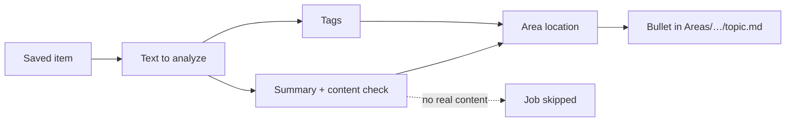

# How the LLM is used

Every save asks a local LLM, through [Ollama](https://ollama.com), three
questions about the saved text: which **tags** fit, what the **summary** is
(and whether there's anything worth keeping at all), and which **Area note**
it belongs in. The answers become one bullet in a note under `Areas/`. This
page walks through each step, with links to the code.

> Links point at line ranges in the current code. If a link lands slightly
> off after a change, search the file for the function name given next to it.



## Talking to Ollama

All requests go through [`call_raw`](../saver/llm.py#L46-L58): one
`POST /api/generate` per question, no streaming and no chat history, so
each question stands alone. The request carries the settings from
[`config.py`](../saver/config.py#L72-L83):

| Setting | Default | Why |
|---|---|---|
| `OLLAMA_MODEL` | `qwen3.8:27b` | Any instruction-following model Ollama serves |
| `OLLAMA_TEMPERATURE` | `0.2` | Low, so the same page gets much the same tags and filing again |
| `OLLAMA_THINK` | `false` | Skips a reasoning model's thinking pass: the answers are short, structured JSON |
| `OLLAMA_NUM_CTX` | `32768` | The context window. The area prompt alone is about 22,000 tokens at 1,500 notes (see [Limits](#limits-and-tuning)) |
| `OLLAMA_TIMEOUT` | `180` | Seconds per request. The first request after a while can be slow: Ollama loads the model first |

Every prompt ends with *"Respond with ONLY valid JSON"* and names the shape
it expects. Models don't always comply, so
[`extract_json`](../saver/llm.py#L14-L43) is forgiving: it drops
`<think>…</think>` blocks, unwraps a ```` ```json ```` fence, takes the
first `{…}` in the text, and rejects a bare value (a list where an object
was asked for). When nothing usable comes back,
[`call`](../saver/llm.py#L66-L72) logs a warning in the job and returns a
safe default (no tags, no area), so the save goes on.

## What text the LLM reads

Each content type builds the text it analyzes in its own save function:

| Saved item | Text analyzed | Where |
|---|---|---|
| Web page | The page's visible text (SingleFile capture, or a plain fetch if that fails) | [`save_generic`](../saver/pipeline.py#L143-L205) |
| SingleFile page from the inbox or an upload | The same, from the captured file | [`save_generic`](../saver/pipeline.py#L143-L205) |
| Git repository | The text of the repository's web page, README included | [`save_git_repo`](../saver/pipeline.py#L210-L255) |
| PDF | The text of the first 20 pages ([`extract_pdf_text`](../saver/fetch.py#L37-L40)). A scan without a text layer uses the file's embedded description instead, framed so the model describes the document | [`save_pdf`](../saver/pipeline.py#L313-L360) |
| YouTube video, media.ccc.de talk | Title and channel (or speakers and conference), then the first 4,000 characters of the Whisper transcript, then the description ([`video_text`](../saver/pipeline.py#L73-L86)). The video is downloaded and transcribed first, so the transcript decides what it's about | [`save_youtube`](../saver/pipeline.py#L365-L406), [`save_ccc_talk`](../saver/pipeline.py#L408-L447) |
| YouTube channel | The channel's title and description (one entry for the whole channel) | [`save_youtube_channel`](../saver/pipeline.py#L449-L517) |

## The three steps

[`Saver.analyze`](../saver/pipeline.py#L93-L107) runs the steps in order,
shows each as a stage in the job ("Tagging", "Summarizing", "Choosing an
Area"), and checks between them whether the job was cancelled.

### 1. Tags

[`extract_tags`](../saver/llm.py#L75-L99) asks for 3 to 5 broad, reusable
tags: lowercase, English, words joined by dashes (`machine-learning`), never
the page title or domain.

The point is a stable vocabulary, so the prompt includes the tags the vault
already uses, as `EXISTING_TAGS`, and asks the model to reuse an existing
spelling instead of inventing a near-duplicate (`ray-marching` next to
`raymarching`). [`collect_existing_tags`](../saver/vaultnotes.py#L94-L118)
builds that list from the tag lines of every Area note:

- most-used first, the top 300 go into the prompt;
- one note counts at most 3 times per tag, so a big crawl that filed
  hundreds of pages into one note can't dictate the whole vocabulary.

The answer is cleaned to a list of strings; anything else becomes "no tags".

### 2. Summary and content check

[`extract_summary`](../saver/llm.py#L102-L144) asks for 3 to 4 sentences
for "someone deciding whether to revisit this saved page later": what the
content covers, what a tutorial teaches, what problem a tool solves.

The same question includes a verdict, `has_content`. It's `false` for:

- login walls, error pages, a bare image or file reference, near-empty text;
- a site's navigation furniture: tag and category archives, feeds of recent
  posts, search results. Their linked articles are worth saving one by one;
  the listing isn't.

A listing whose subject is the collection itself is kept: a book series'
volume list, a bibliography, a curated directory of tools.

When the verdict is `false`, the save stops with a
`ContentFreeError`, and the job ends as **skipped**, not failed
([`JobManager._run`](../saver/jobs.py#L195-L218)). The UI then offers
**Keep anyway**, which retries with `allow_thin`: the verdict is ignored,
and if the model left the summary empty,
[`summarize_plain`](../saver/llm.py#L147-L164) asks again without the
verdict. For a video, a rejected save also removes the download it just
made ([`analyze_download`](../saver/pipeline.py#L120-L130)), since nothing
would link to it.

### 3. Area location

[`extract_area`](../saver/llm.py#L188-L217) picks the note the bullet goes
into. It doesn't see the saved text again: it gets the **tags**, the
**summary**, and the **whole `Areas/` tree**, every folder and note name,
drawn by [`tree_to_string`](../saver/util.py#L50-L61). The rules it gets:

- **Reuse first.** A note collects every save about one specific subject
  (a library, a game, a technique). If a note about the same subject
  exists, use it; two different subjects get two notes, even in the same
  folder.
- **Keep folders small.** If the target folder already holds more than
  about 15 notes, nest the new one in a narrower subfolder, reusing a
  fitting existing subfolder first.
- **Shape.** 2 to 4 levels deep, ending in a `.md` file, e.g.
  `programming/rust/error-handling.md`.
- **No note named after its own folder** (`productivity/productivity.md`):
  that name is the folder note, whose index the service regenerates.

The answer isn't trusted as it is.
[`validate_area_path`](../saver/vaultnotes.py#L121-L144) rejects a path
that would leave `Areas/` (`../`), doesn't end in `.md`, or collides with a
folder note. A rejected or empty answer files the bullet in
`Areas/uncategorized.md` instead, for you to move later.

[`materialize_area`](../saver/vaultnotes.py#L147-L151) then creates the
note, and for a new folder:

- [`ensure_waypoints`](../saver/vaultnotes.py#L56-L85) gives every folder
  on the path a folder note, which the service fills with an index of the
  folder, when the note sits at least two folders deep
  (`programming/lua/json.md`; `career/work.md` gets none);
- [`ensure_graph_color_group`](../saver/vaultnotes.py#L36-L53) gives each
  new top-level area its own color in Obsidian's graph view.

## Writing the entry

[`format_area_bullet`](../saver/vaultnotes.py#L154-L164) turns the answers
into one bullet: the tags as the bullet's own line, then the summary, then
the links (the capture or README, a video's ▶ Watch and Transcript links)
and the source URL:

```
- #lua #json #libraries
	This page documents json.lua, a lightweight, pure Lua library for …
	[[Dumps/git/github.com/rxi/json.lua/README.md]] · [Browse files](https://…/blobs/git/github.com/rxi/json.lua/)
	https://github.com/rxi/json.lua
```

[`replace_area_entry`](../saver/vaultnotes.py#L181-L208) appends it to the
note under the vault lock. On a re-save, it first removes the previous
bullet, found by the exact text the registry stored, in the same locked
step. A re-save asks all three questions again, so the entry can move to a
different note. When the service manages the folder indexes, they're
refreshed right after ([`write_entry`](../saver/pipeline.py#L114-L118)).

## Two more questions

- **A title for the file name.**
  [`extract_title`](../saver/llm.py#L167-L185) reads the first 3,000
  characters and returns the document's own title. It's asked for every
  web page, because a page's `<title>` is often the same across a whole
  site, and for PDFs without an embedded title (common for LaTeX papers).
- **"Is this a git repository?"** For a page on an unknown host, a
  self-hosted Gitea or GitLab for example,
  [`detect_git_repo`](../saver/pipeline.py#L611-L648) asks
  [`detect_git_repo_prompt`](../saver/llm.py#L220-L238) for the owner and
  repository name. It's only asked when the page shows signs of a code
  forge (a forge's name, a clone URL); ordinary articles skip it. The host
  always comes from the page's own address, never from the model, and the
  reconstructed URL must answer before it's cloned.

## Limits and tuning

- **Prompt size.** The area prompt carries the whole `Areas/` tree, about
  63,000 characters (22,000 tokens) for 1,500 notes, and it grows with the
  vault. Raise `OLLAMA_NUM_CTX` for a much larger vault, within what your
  graphics card's memory allows.
- **Long pages.** For tags and summary the text goes in untrimmed (PDFs
  stop at 20 pages). A very long page, plus the prompt, can exceed
  `OLLAMA_NUM_CTX`; Ollama then cuts the prompt, and the answer gets worse
  without an error.
- **Speed.** A save makes three requests (tags, summary, area); a web page
  makes four, with the title, and five when the repository check runs. The first one after Ollama has been idle also
  pays for loading the model, which can take minutes for a large model;
  the job shows it as a long "Tagging" stage.
- **Model choice.** Smaller models work, at the cost of looser tags and
  filing. Whatever the model, results are only as stable as the low
  temperature makes them: a re-save may pick different tags or another note.
